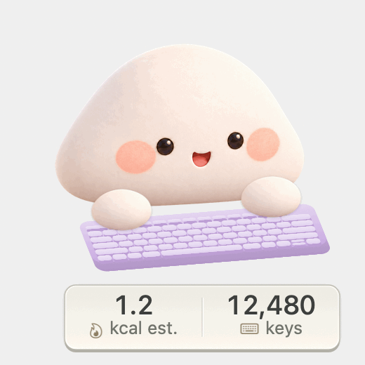
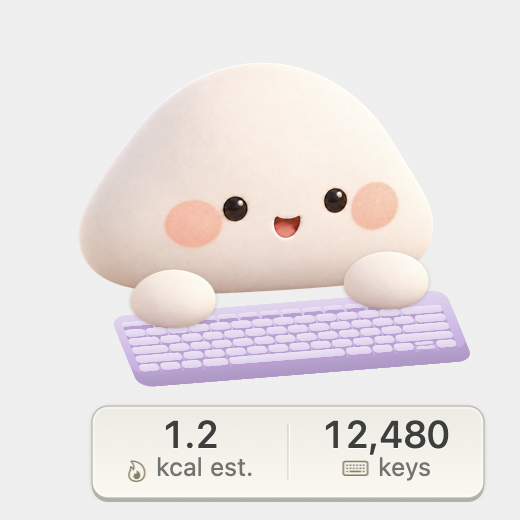
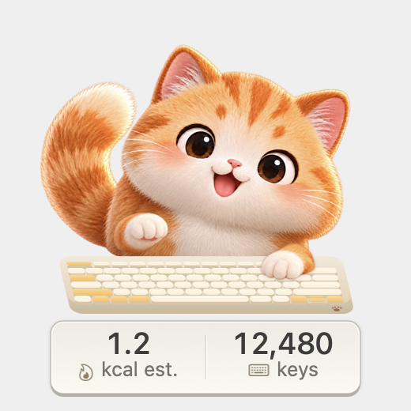
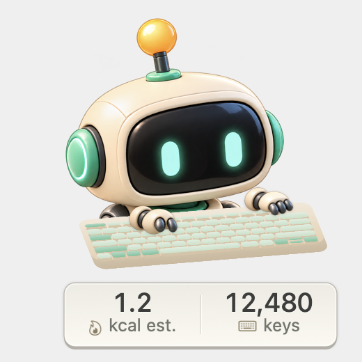
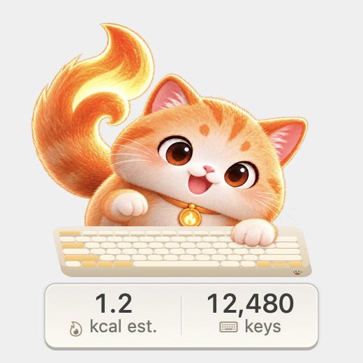

# Mochi Tracker

A tiny native macOS companion that types along with you, counts your daily key presses, and shows an optional calorie estimate.

Choose **Mochi**, **Keycat**, **Pip Bot**, or **Spark Keycat**. Drag your companion to a corner, keep typing in your usual app, and watch its paws land on the matching keys.

<p align="center">
  
</p>

*Rendered demo with scripted key poses and illustrative totals. It uses the app’s actual AppKit renderer; it is not a recording of someone’s typing.*

## Meet the companions

<table>
  <tr>
    <td align="center"><br><strong>Mochi</strong></td>
    <td align="center"><br><strong>Keycat</strong></td>
  </tr>
  <tr>
    <td align="center"><br><strong>Pip Bot</strong></td>
    <td align="center"><br><strong>Spark Keycat</strong></td>
  </tr>
</table>

*Gallery numbers are sample values. The floating widget is transparent outside the character, keyboard and counter panel.*

## What it does

- Mirrors supported physical key positions with independent paws and keycap highlights.
- Counts today’s non-repeated key-down events; resets with your local calendar date.
- Displays larger numbers on a matte ivory or graphite instrument-style counter panel.
- Supports dragging, always-on-top placement, four characters, size adjustment, pause/hide and animation previews.
- Honors Reduce Motion and offers fixed Light/Dark counter themes alongside wallpaper-based Automatic mode.
- Runs locally with no account, third-party runtime dependency, AI model, telemetry or runtime network calls.

## Build and install

Requires **macOS 13+** and a **Swift 6 toolchain** with Apple’s macOS SDK. Development and local verification used Apple Silicon with Xcode/Swift 6.4; Intel builds have not been verified. This repository contains source, not a notarized public installer.

```sh
git clone https://github.com/Wasif-Karim03/Mochi_tracker.git
cd Mochi_tracker
swift test
bash scripts/build-app.sh
mkdir -p "$HOME/Applications"
ditto "dist/Typing Companion.app" "$HOME/Applications/Typing Companion.app"
open "$HOME/Applications/Typing Companion.app"
```

The built application is named **Typing Companion**. Quit an existing copy before replacing it. The script uses ad-hoc signing by default. To reuse an existing development certificate, pass its name or fingerprint through `SIGNING_IDENTITY`:

```sh
SIGNING_IDENTITY="YOUR_EXISTING_SIGNING_IDENTITY" bash scripts/build-app.sh
```

Keep the installed path and signing identity consistent across updates to reduce permission problems. No certificate or private key is included in the repository. See [development notes](docs/implementation.md) for signing and rendering details.

## First launch

1. Open Settings from the companion’s right-click menu or keyboard menu-bar icon.
2. Click **Enable Input Monitoring…**, then enable the exact installed **Typing Companion** app in macOS Privacy & Security → Input Monitoring yourself.
3. Quit and reopen if macOS asks, or use **Reconnect listener**. Confirm the status says **Counting locally**.
4. Optionally enter your weight in kilograms and save to enable the calorie estimate.

Right-click also lets you switch characters, preview typing without changing totals, pause counting, hide/show, and recover the widget to the top-right corner. The nonactivating widget is designed to preserve focus in your typing app.

## Privacy and calorie estimates

The listen-only event tap uses physical key codes **temporarily in memory** to animate key positions. It never converts events into typed text, saves key codes, records app names or transmits activity. Only daily key count, active seconds, optional weight and visual settings persist locally in UserDefaults. Secure Input and monitoring gaps clear animation state. No Accessibility or Screen Recording permission is requested.

Calories are **estimated energy above rest**, not a measured calories-per-key conversion:

```text
estimated extra kcal = (1.3 − 1.0) × weight in kg × active typing hours
```

Active time is credited only between accepted presses at most five seconds apart. Isolated presses and idle tails add no time. This five-second heuristic is an implementation choice, not a metabolic measurement. The estimate stays unavailable until a weight is entered and is unsuitable as a precise exercise or dietary tracker. The activity rating comes from the [2024 Compendium](https://pacompendium.com/miscellaneous/).

## Development

```sh
swift test
bash scripts/render-previews.sh .build/previews
bash scripts/render-previews.sh .build/previews --gif
```

Preview rendering requires a macOS GUI session. It draws only the app’s own view and synthetic values—no screen capture or system key injection.

| Path | Purpose |
| --- | --- |
| `Sources/CompanionCore/` | Daily ledger, held-key model and shared keyboard projections |
| `Sources/TypingCompanion/` | AppKit panel, settings, event monitoring and drawing |
| `Sources/TypingCompanion/Resources/` | Character artwork and runtime sprite atlases |
| `Tests/CompanionCoreTests/` | Accounting, key-state and geometry regression tests |
| `scripts/` | Build/signing and reproducible preview tools |
| `docs/` | Implementation notes, asset notes and gallery previews |

Read [implementation and verification](docs/implementation.md) and [artwork notes](docs/assets.md).

## Current limits

The mapping represents a **US ANSI Mac keyboard**. Other layouts, numpads, Touch ID/power, media/system-control events and remapping utilities are not exact replicas. Modifier-only presses animate but do not count; Caps Lock is a brief tap indication. For chords, every supported cap highlights while each paw contacts the newest key on its half.

Automatic theme selection samples the configured wallpaper, not covering windows; each solid counter panel maintains its own text contrast. Secure Input, revoked access or listener failures can create counting gaps. Totals save every five seconds and on normal quit/sleep, so a crash may lose the newest five seconds.
