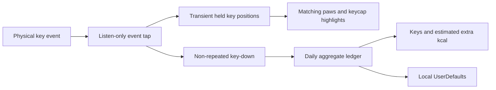

# Implementation and verification

## Architecture

Swift Package targeting macOS 13+, tools version 6.0 and Swift language mode 5. AppKit/Core Graphics implement the panel and listen-only key-event tap; Carbon supplies Secure Input status, and ImageIO reads local wallpaper images and exports rendered previews. There are no third-party runtime dependencies.



`EventMonitor.swift` routes key-down/up and modifier changes on the main run loop. It never translates events into text or persists payloads. Monitoring gaps, pause and Secure Input clear transient positions. Caps Lock uses a guarded short pulse. The preview uses a separate scene and cannot change totals or release real held keys.

`KeyboardModel.swift` defines US ANSI key geometry and bounded held state. `KeyboardProjection.swift` shares affine transforms between keyboard caps and paw contact points. New presses contact their mapped cap immediately; quick taps remain visible for 100 ms, held keys remain down, and only release/rest travel interpolates. Reduce Motion preserves matching positions without travel.

`CompanionView.swift` crops and loads local body/paw sprites, draws the transparent panel and instrument-style counters. All four themes retain individual Mac key geometry. The solid ivory/graphite panel uses paired contrasting text, a fine rim, subtle relief and subdued line icons. Values fit their columns, including at the 180-point minimum widget width. Wallpaper sampling chooses the automatic theme without capturing the display.

`TypingLedger.swift` persists only the current local day, count and active seconds. Optional weight and visual settings use the same local UserDefaults domain, `local.wasif.typingcompanion`. Accepted presses separated by at most five seconds credit their interval; pause/restart/day changes break sessions. Net energy estimate is 0.3 × kg × active hours, unavailable without a valid optional weight. The app does not estimate finger work from individual keystrokes.

## Build and signing

```sh
swift test
bash scripts/build-app.sh
```

The bundle is generated at `dist/Typing Companion.app`, version 0.4.1. `SIGNING_IDENTITY` can select an existing local certificate; the default is ad-hoc. The script verifies the resulting signature with `codesign --verify --deep --strict`. A consistent certificate-based identity is preferable for repeated local updates. The source does not include a certificate, private key or notarized distribution.

Grant Input Monitoring only after installing at a consistent path. If a replacement app reports permission missing while an old switch appears on, the grant may still refer to the previous signature. Remove the stale entry and add the exact installed copy, or reset only this app’s approval:

```sh
tccutil reset ListenEvent local.wasif.typingcompanion
```

The user must grant access again and reopen the unchanged final app. Do not reset all app permissions or modify the TCC database. A visible switch alone does not prove the listener is active; check **Counting locally** and actual typing.

## Reproducing previews

```sh
bash scripts/render-previews.sh .build/previews
bash scripts/render-previews.sh .build/previews --gif
bash scripts/render-previews.sh .build/small-checks 180 '123.4 kcal est.  ·  123,456 keys' busy
bash scripts/render-previews.sh .build/large-checks 360 '— kcal est.  ·  0 keys' busy
```

The wrapper builds the debug package, locates its module/object/resource paths, then compiles the native rendering harness. The wrapper handles Xcode-backed and conventional SwiftPM object/module path shapes; the Xcode-backed path has been locally verified. A macOS GUI session is required.

Normal mode emits 48 poses: four characters × two themes × six poses. Supplying a width emits idle snapshots for all characters/themes. The optional `busy` flag adds black/white/pink/teal stripes to exercise counter contrast. GIF mode generates scripted Mochi key poses with example totals; it is a rendered demo, not proof of live physical input. All generated artifacts stay under `.build` unless an explicit output folder is chosen.

## Verification actually performed

- 15 Swift tests pass across accounting, repeat/chord/modifier state and frontal/angled projection geometry.
- Native harness assertions cover held chords, repeat deduplication, release, clearing, immediate same-hand contact, projected targets and bundled sprite loading.
- Normal pose snapshots inspected across all four characters; minimum 180-point and larger 360-point snapshots checked in both themes, including busy backgrounds, six-digit counts and unavailable calories.
- Debug/release builds and strict signature verification passed on Apple Silicon.
- Installed app inspected through native UI: all four character selections, saved totals on quit/relaunch, active listener, visible calorie estimate and readable small counter panels.
- Bounded independent source/render review found no blocking geometry, state, privacy or clipping defects after corrections.

Actual Secure Input/revocation, multiple displays, fullscreen/Spaces, drag focus preservation and physical repeat behavior have not been exhaustively exercised. Intel builds have not been verified. Automated/offscreen rendering is distinct from live physical typing verification.
